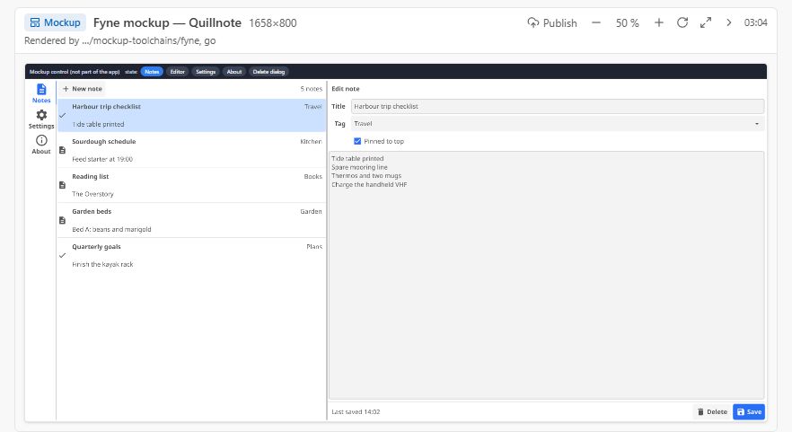
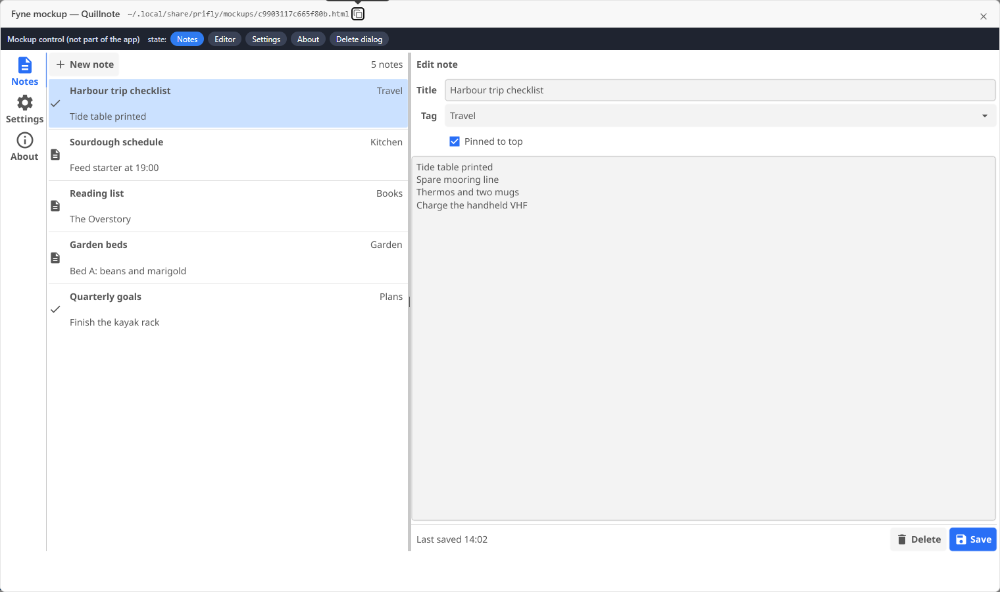

# prifly-mockup-fyne

A prifly mockup-stack recipe for **Fyne**, the Go native GUI toolkit. It tells a
prifly session how to render a mockup with the real Fyne widgets: Fyne's own WebAssembly target, packed into one
self-contained HTML page, instead of an HTML imitation of a Fyne window.

## What is in it

- `mockup-stacks/fyne.md`: the recipe (frontmatter that prifly's loader reads, then Steps, Gotchas, States).
- `mockup-stacks/fixtures/fyne/`: a small proof project, "Quillnote" (tabs, a list, a form, a confirm dialog, settings), sources
  only. `build.sh` compiles it to wasm; prifly's checker runs it when `go` is on the PATH.
- `scripts/check.ts`: a Bun-only validator of the recipe frontmatter, run by CI.

## How prifly uses a pack

A pack is a git repository of recipes. prifly clones it into its data folder and reads `mockup-stacks/*.md` from it, in the layer
between the user's own recipes and the built-in ones. Add this pack with `packs.json` in prifly's mockup-stacks folder:

```json
{ "packs": [{ "name": "prifly-mockup-fyne", "url": "https://github.com/jimmy927/prifly-mockup-fyne.git" }] }
```

or with the host's environment: `PRIFLY_MOCKUP_STACK_PACKS=prifly-mockup-fyne=https://github.com/jimmy927/prifly-mockup-fyne.git`.
The host pulls at most once a day and never makes a tool call wait for it. A session then gets this recipe from
`mockup_recipe` when the project has `fyne.io/fyne/v2` in its `go.mod`, or when asked for the stack `fyne`.

## The recipe in one paragraph

Build the app with `fyne package -os wasm --release` (Go 1.23, Fyne 2.8.1: about 13 s, a 35 MB module), pack the `.wasm` and
`wasm_exec.js` with the kit's `pack-wasm.py generic` into one 14.7 MB page, and start it from a small `boot.js` that works around
three things: Fyne 2.8 panics when IndexedDB is unavailable in a file page, the kit's ready signal fires before Fyne's first frame,
and a mockup-control strip above the canvas must not shift it. States are `#hash` links in that strip. The Steps and Gotchas in
`mockup-stacks/fyne.md` have the commands, timings and sizes.

## Screenshots

The recipe's card in prifly:



A mockup rendered by it:



## Checking

```
bun scripts/check.ts
```

validates the frontmatter against the loader's schema. From a prifly checkout,
`bun run mockup-stacks:check --layer packs` also builds the fixture.

## License

MIT, see `LICENSE`.
